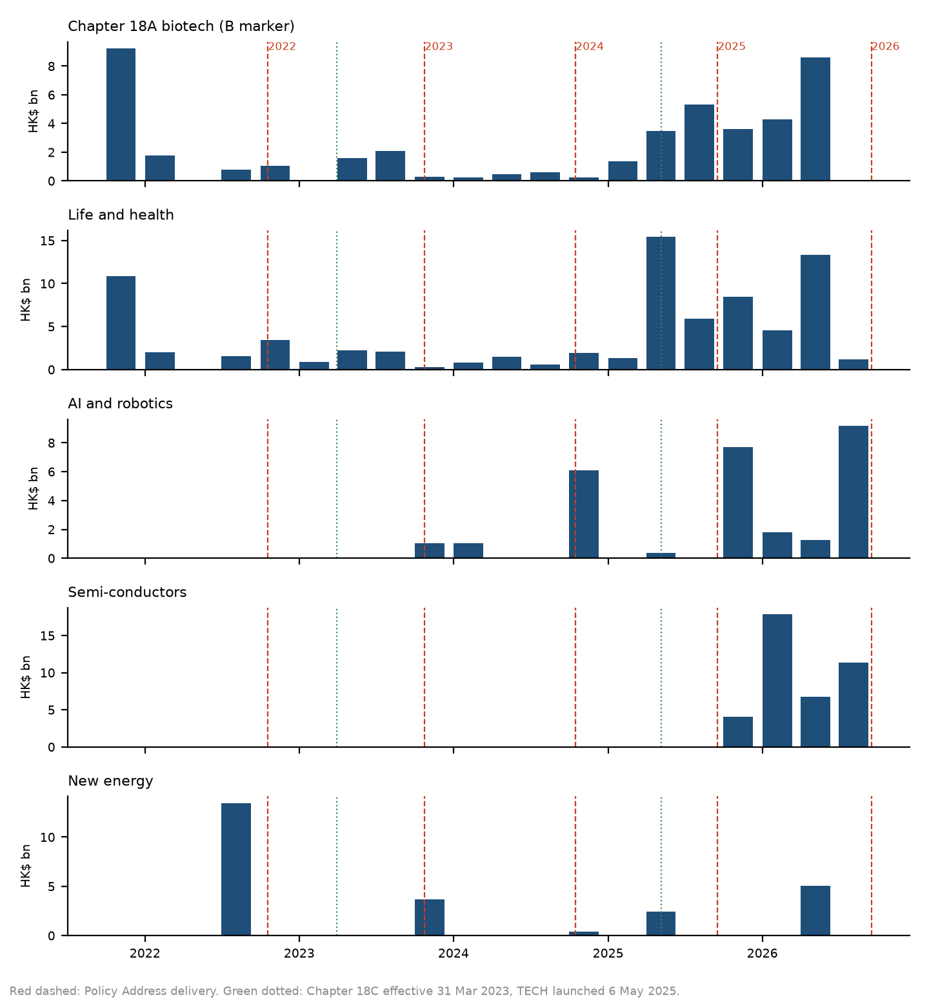
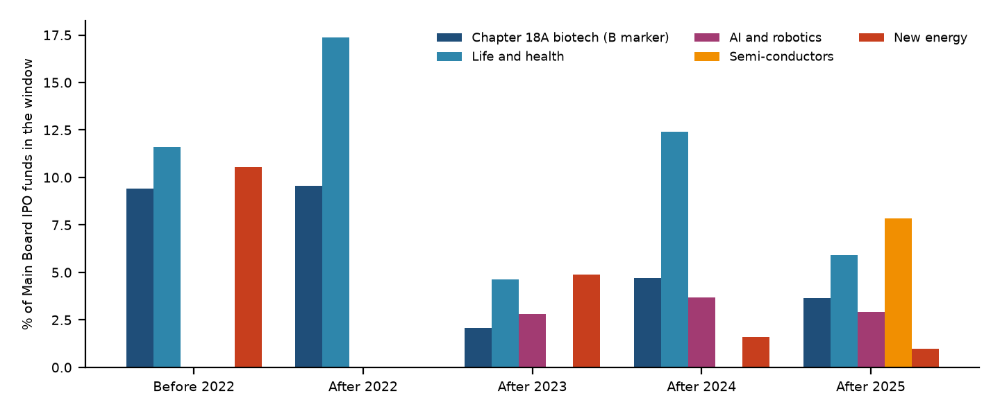
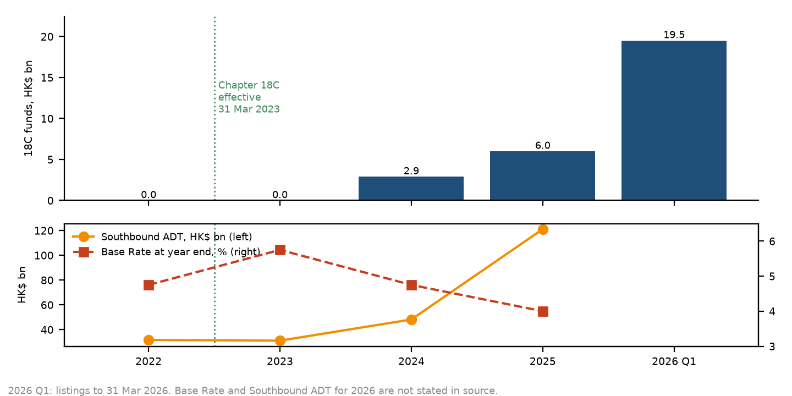

# Funding and the market after each address

Prepared for CHEUNG Yuk Yuen, AI Application Trainee, Department of Physics.
Period: John Lee took office on 1 July 2022. Policy Addresses from 19 October 2022 to 16 September 2026. Market sources read on 7 October 2026.

The question is what the Government said it would fund, and what happened on HKEX to the industries it named after that address. The board total is context. Each industry is counted from every Main Board IPO in the HKEX New Listing Reports.

A funding row is kept only when one sentence names an amount and commits, earmarks, injects, redeploys, or sets up a fund for an industry, technology, or cultural-industry programme. The verb decides whether the money is new in that address.

## What the address said about the market

These sentences describe the market up to delivery. They are context, not the outcome.

- 2022, delivered 2022-10-19. The address says Hong Kong has an active stock market. It states no IPO total and no turnover.
- 2023, delivered 2023-10-25. Paragraph 71 accepts the recommendations of the Task Force on Enhancing Stock Market Liquidity. It states no IPO total.
- 2024, delivered 2024-10-16. The financial-market paragraphs set a direction for artificial intelligence, tokenisation, and stablecoins. They state no IPO total.
- 2025, delivered 2025-09-17. Paragraph 92, delivered on 17 September, says the Hang Seng Index had risen by over 20% year to date, average daily turnover had reached HK$250 billion, and IPO funds by the end of August exceeded HK$130 billion. Those figures pre-date delivery.
- 2026, delivered 2026-09-16. Paragraph 36, delivered on 16 September, says IPO funds as of the end of August exceeded HK$340 billion. The HKEX highlights page dates that total to 31 August.

## Stated government amounts

| Year | Programme | Amount | Status | Verb as printed | Industries |
| --- | --- | --- | --- | --- | --- |
| 2022 | Co-Investment Fund | 30 HK$ billion | new in this address | "set aside $30 billion from the Future Fund to establish the Co-Investment Fund" | Enterprises setting up in Hong Kong |
| 2022 | RAISe+ Scheme | 10 HK$ billion | new in this address | "We will earmark $10 billion to launch" | University research teams with potential to become start-ups |
| 2022 | Strategic Tech Fund | 5 HK$ billion | already in place before this address | "making use of the $5 billion Strategic Tech Fund" | Life and health technology, AI and data science, advanced manufacturing and new energy technology |
| 2023 | New Industrialisation Acceleration Scheme | 10 HK$ billion | new in this address | "set up a $10 billion New Industrialisation Acceleration Scheme" | Life and health technologies, AI and data science, advanced manufacturing, new energy technologies |
| 2023 | Film Development Fund and CreateSmart Initiative | 4.3 HK$ billion | new in this address | "We will also inject a total of $4.3 billion" | Film, cultural and creative industries |
| 2024 | Research Matching Grant Scheme | 1.5 HK$ billion | new in this address | "The Government will launch a new round of Research Matching Grant Scheme totalling $1.5 billion" | Research at institutions |
| 2024 | I&T Industry-Oriented Fund | 10 HK$ billion | new in this address | "setting up a $10 billion I&T Industry-Oriented Fund" | Life and health technology, AI and robotics, semi-conductors and smart devices, advanced materials, new energy |
| 2024 | Innovation and Technology Venture Fund | 1.5 HK$ billion | new in this address | "We will redeploy $1.5 billion" | Start-ups in strategic industries |
| 2024 | I&T Accelerator Pilot Scheme | 180 HK$ million | new in this address | "The Government will launch the I&T Accelerator Pilot Scheme with a funding allocation of $180 million" | Start-up accelerators |
| 2024 | New Energy Transport Fund | 750 HK$ million | new in this address | "The Government will earmark around $750 million" | Electric taxis and franchised buses, hydrogen fuel-cell heavy vehicles |
| 2025 | Frontier Technology Research Support Scheme | 3 HK$ billion | already in place before this address | "The Government earlier announced the launch of the $3 billion" | AI and other frontier research |
| 2025 | Hong Kong AI Research and Development Institute | 1 HK$ billion | already in place before this address | "We have also earmarked $1 billion" | AI research, transfer, and use cases |
| 2025 | Aerospace Technology special call | 100 HK$ million | already in place before this address | "has allocated over $100 million" | Aerospace technology |
| 2026 | Innovation and Technology Venture Fund, enhanced scheme | 1 HK$ billion | already in place before this address | "An additional $1 billion has been earmarked" | I&T venture funds |
| 2026 | Artificial Intelligence Subsidy Scheme | 1 HK$ billion | new in this address | "The Government will inject $1 billion" | High-performance computing for the AI institute |
| 2026 | AI for Welfare Lab | 300 HK$ million | new in this address | "A sum of $300 million will be allocated" | AI in social welfare services |
| 2026 | Construction Innovation and Technology Fund | 1 HK$ billion | already in place before this address | "We injected $1 billion into the Construction Innovation and Technology Fund (CITF) this year" | I&T in the construction industry |

Source for every row: the English XML for that year, https://www.ceo.gov.hk/public/open-data/en/policy_address/paYEAR.xml. Notes per row are in the workbook, sheet Inputs.

| Address | New in this address, HK$ million | Already in place, HK$ million |
| --- | --- | --- |
| 2022 | 40,000.0 | 5,000.0 |
| 2023 | 14,300.0 | 0.0 |
| 2024 | 13,930.0 | 0.0 |
| 2025 | 0.0 | 4,100.0 |
| 2026 | 1,300.0 | 2,000.0 |

The 2025 address states no new amount for an industry. Its three amounts were announced, earmarked, or allocated before 17 September 2025.

## HKEX board in the following calendar year

| Address | Delivered | Outcome window | Label |
| --- | --- | --- | --- |
| 2022 | 2022-10-19 | 2023 full year | following year recorded, source does not attribute it to the address |
| 2023 | 2023-10-25 | 2024 full year | following year recorded, source does not attribute it to the address |
| 2024 | 2024-10-16 | 2025 full year | following year recorded, source does not attribute it to the address |
| 2025 | 2025-09-17 | 2026, first eight months | following year only partly published |
| 2026 | 2026-09-16 | 2027 not published | following year not yet published |

| Market year | Indicator | Value | Unit | Printed change | As of | Source |
| --- | --- | --- | --- | --- | --- | --- |
| 2023 | IPO | 46294.9 | HK$ million | -55.8% | 29 Dec 2023 | https://www.hkex.com.hk/-/media/HKEX-Market/Market-Data/Statistics/Consolidated-Reports/Annual-Market-Statistics/FY_2023-Annual-Market-Stat_Eng.pdf |
| 2023 | ADT | 105012 | HK$ million | -15.9% | 29 Dec 2023 | https://www.hkex.com.hk/-/media/HKEX-Market/Market-Data/Statistics/Consolidated-Reports/Annual-Market-Statistics/FY_2023-Annual-Market-Stat_Eng.pdf |
| 2024 | IPO | 87477.8 | HK$ million | +88.9% | 31 Dec 2024 | https://www.hkex.com.hk/-/media/HKEX-Market/Market-Data/Statistics/Consolidated-Reports/Annual-Market-Statistics/2024FY-Ann-Mkt-Stat_eng.pdf |
| 2024 | ADT | 131825 | HK$ million | +25.5% | 31 Dec 2024 | https://www.hkex.com.hk/-/media/HKEX-Market/Market-Data/Statistics/Consolidated-Reports/Annual-Market-Statistics/2024FY-Ann-Mkt-Stat_eng.pdf |
| 2025 | IPO | 286.9 | HK$ billion | +226% | 31 Dec 2025 | https://www.hkex.com.hk/-/media/HKEX-Market/News/News-Release/2026/260226news/260226news_eng.pdf |
| 2025 | ADT | 249.8 | HK$ billion | +90% | 31 Dec 2025 | https://www.hkex.com.hk/-/media/HKEX-Market/News/News-Release/2026/260226news/260226news_eng.pdf |
| 2026 | IPO | 342.4 | HK$ billion | +153% | 31 Aug 2026 | https://www.hkex.com.hk/Market-Data/Statistics/Consolidated-Reports/HKEX-Monthly-Market-Highlights?sc_lang=en |
| 2026 | ADT | 282.5 | HK$ billion | +14% | 31 Aug 2026 | https://www.hkex.com.hk/Market-Data/Statistics/Consolidated-Reports/HKEX-Monthly-Market-Highlights?sc_lang=en |

2027 is not stated in source. These totals are context for the industry rows. A funding amount is not divided by them, because a government fund and the money investors pay for new shares are different sums.

## Every IPO, by the industry the address named

Source: HKEX New Listing Reports, Main Board, https://www2.hkexnews.hk/-/media/HKEXnews/Homepage/New-Listings/New-Listing-Information/New-Listing-Report/Main/NLR2021_Eng.xlsx through NLR2026_Eng.xlsx. Copies are in `data/hkex_nlr/`. The 2026 report runs up to 29 September 2026. Funds raised is the Hong Kong offer row plus the international offer row. Listings by introduction raise nothing and count as IPOs with zero funds.

HKEX prints no industry column. Its only industry tags are the B marker for Chapter 18A biotech and the P marker for pre-commercial Chapter 18C companies. Every other row below is a keyword screen on the company name. It is called a name screen and it is a lower bound.

Name-screen keywords, matched case-insensitively:

- Life and health: `pharm|bio|therap|medic|health|hospital|genetic|gene\b|diagnos|vaccin|clinic`
- AI and robotics: `\brobo|\bai\b|artificial intelligence|autonomous|\bdeep|unmanned`
- Semi-conductors: `semiconductor|chip|microelectronic|integrated circuit|silicon|wafer`
- New energy: `energy|batter|hydrogen energy|solar|photovolt|lithium|new power|charging|electric vehicle`
- Film and creative: `film|pictures|movie|animation|studio|entertainment|\bmedia\b|\bculture|\bcultural`
- Aerospace: `aero|aircraft|aviation|\bspace|satellite|drone`
- Construction: `construction|(?<!gene )engineering|building`

Removed by hand, with the reason the name gives:

- 02370 Redco Healthy Living Company Limited, from Life and health. Healthy Living is property management.
- 02530 Numans Health Food Holdings Company Limited, from Life and health. Health Food is food.

Windows run from a delivery date to the day before the next address. The first column is the 12 months before the first address. Each cell is IPOs / HK$ million / share of the Main Board total in the same window, from the same file.

- Before 2022: 19 Oct 2021 to 18 Oct 2022
- After 2022: 19 Oct 2022 to 24 Oct 2023
- After 2023: 25 Oct 2023 to 15 Oct 2024
- After 2024: 16 Oct 2024 to 16 Sep 2025
- After 2025: 17 Sep 2025 to 15 Sep 2026
- After 2026: 16 Sep 2026 to 29 Sep 2026

| Policy industry | Tag basis | Before 2022 | After 2022 | After 2023 | After 2024 | After 2025 | After 2026 |
| --- | --- | --- | --- | --- | --- | --- | --- |
| Chapter 18A biotech (B marker) | HKEX B marker | 12 / 11,999.7 / 9.4% | 9 / 4,526.9 / 9.6% | 4 / 1,557.1 / 2.1% | 11 / 8,283.3 / 4.7% | 17 / 18,604.4 / 3.7% | 0 / 0.0 / 0.0% |
| Life and health | name screen | 17 / 14,814.5 / 11.6% | 17 / 8,215.2 / 17.4% | 7 / 3,491.0 / 4.6% | 18 / 21,777.3 / 12.4% | 29 / 30,044.8 / 5.9% | 0 / 0.0 / 0.0% |
| AI and robotics | name screen | 0 / 0.0 / 0.0% | 0 / 0.0 / 0.0% | 2 / 2,101.1 / 2.8% | 2 / 6,454.9 / 3.7% | 9 / 14,791.6 / 2.9% | 1 / 5,177.9 / 25.0% |
| Semi-conductors | name screen | 0 / 0.0 / 0.0% | 0 / 0.0 / 0.0% | 0 / 0.0 / 0.0% | 0 / 0.0 / 0.0% | 12 / 39,983.4 / 7.9% | 0 / 0.0 / 0.0% |
| New energy | name screen | 1 / 13,458.0 / 10.5% | 0 / 0.0 / 0.0% | 2 / 3,687.4 / 4.9% | 3 / 2,800.0 / 1.6% | 1 / 5,060.7 / 1.0% | 0 / 0.0 / 0.0% |
| Film and creative | name screen | 2 / 420.1 / 0.3% | 2 / 635.3 / 1.3% | 0 / 0.0 / 0.0% | 0 / 0.0 / 0.0% | 1 / 444.4 / 0.1% | 0 / 0.0 / 0.0% |
| Aerospace | name screen | 0 / 0.0 / 0.0% | 0 / 0.0 / 0.0% | 1 / 1,513.2 / 2.0% | 0 / 0.0 / 0.0% | 0 / 0.0 / 0.0% | 0 / 0.0 / 0.0% |
| Construction | name screen | 1 / 125.0 / 0.1% | 2 / 1,790.0 / 3.8% | 2 / 317.4 / 0.4% | 0 / 0.0 / 0.0% | 1 / 174.7 / 0.0% | 0 / 0.0 / 0.0% |
| Main Board, all IPOs | NLR rows | 85 / 127,696.1 / 100% | 79 / 47,269.0 / 100% | 67 / 75,293.8 / 100% | 85 / 175,474.3 / 100% | 165 / 508,850.3 / 100% | 6 / 20,708.6 / 100% |

Life and health includes the Chapter 18A row. The After 2026 window is 14 days long.

## Companies the name screen misses

HKEX does not print these companies' industries in the New Listing Reports. The industry is the trainee's reading, so the funds sit beside the totals above and are not added in.

| Code | Company | Listed | Window | Industry, trainee's reading | HK$ million | Basis |
| --- | --- | --- | --- | --- | --- | --- |
| 03750 | Contemporary Amperex Technology Co., Limited - H shares | 2025-05-20 | After 2024 | New energy | 41,005.7 | Battery maker. Named among the largest 2025 IPOs in the Listing Committee Report 2025, p.2, without an industry. |
| 06082 | Shanghai Biren Technology Co., Ltd.- H shares | 2026-01-02 | After 2025 | Semi-conductors | 6,420.4 | GPU designer. Chapter 18C, HKEX 18C Explained. |
| 02577 | InnoScience (Suzhou) Technology Holding Co., Ltd. - H shares | 2024-12-30 | After 2024 | Semi-conductors | 1,451.3 | Gallium-nitride chip maker. |
| 02533 | Black Sesame International Holding Limited | 2024-08-08 | After 2023 | Semi-conductors | 1,036.0 | Automotive AI chip designer. Chapter 18C, HKEX 18C Explained. |
| 00100 | MiniMax Group Inc. - W - P | 2026-01-09 | After 2025 | AI and robotics | 5,540.2 | AI model developer. Chapter 18C, P marker in the NLR. |
| 02513 | Knowledge Atlas Technology Joint Stock Company Limited - H shares | 2026-01-08 | After 2025 | AI and robotics | 5,000.4 | AI model developer. Chapter 18C, HKEX 18C Explained. |
| 00800 | WeRide Inc. - W | 2025-11-06 | After 2025 | AI and robotics | 2,391.6 | Autonomous driving. Chapter 18C, HKEX 18C Explained. |
| 02525 | Hesai Group - W | 2025-09-16 | After 2024 | AI and robotics | 4,784.3 | Lidar maker. Named as a homecoming listing in the Listing Committee Report 2025, p.2. |

The largest effect is new energy. In the window after the 2024 address the screen finds HK$2,800.0 million, 1.6% of the Main Board. With Contemporary Amperex Technology it would be HK$43,805.7 million, 25.0%.

## Timing

The New Listing Report prints the prospectus date and the listing date, not the date the application was filed. The preparation time before a listing therefore cannot be measured from it. The table below gives each industry's share from each delivery date to 29 September 2026, so a listing that came late is still counted after the address that named its industry.

| Industry | First listing in the data | From 2022 | From 2023 | From 2024 | From 2025 | From 2026 |
| --- | --- | --- | --- | --- | --- | --- |
| Chapter 18A biotech (B marker) | 2021-10-19 | 32,971.9 (4.0%) | 28,444.9 (3.6%) | 26,887.8 (3.8%) | 18,604.4 (3.5%) | 0.0 (0.0%) |
| Life and health | 2021-10-19 | 63,528.3 (7.7%) | 55,313.1 (7.1%) | 51,822.1 (7.4%) | 30,044.8 (5.7%) | 0.0 (0.0%) |
| AI and robotics | 2023-12-29 | 28,525.5 (3.4%) | 28,525.5 (3.7%) | 26,424.4 (3.7%) | 19,969.5 (3.8%) | 5,177.9 (25.0%) |
| Semi-conductors | 2025-12-05 | 39,983.4 (4.8%) | 39,983.4 (5.1%) | 39,983.4 (5.7%) | 39,983.4 (7.6%) | 0.0 (0.0%) |
| New energy | 2022-07-13 | 11,548.2 (1.4%) | 11,548.2 (1.5%) | 7,860.8 (1.1%) | 5,060.7 (1.0%) | 0.0 (0.0%) |
| Film and creative | 2022-08-10 | 1,079.7 (0.1%) | 444.4 (0.1%) | 444.4 (0.1%) | 444.4 (0.1%) | 0.0 (0.0%) |
| Aerospace | 2024-07-12 | 1,513.2 (0.2%) | 1,513.2 (0.2%) | 0.0 (0.0%) | 0.0 (0.0%) | 0.0 (0.0%) |
| Construction | 2022-10-10 | 2,282.1 (0.3%) | 492.0 (0.1%) | 174.7 (0.0%) | 174.7 (0.0%) | 0.0 (0.0%) |

First listing in the data counts from 2021-10-19. Semi-conductors first appears on 2025-12-05, about 14 months after the 16 October 2024 address that named it, and inside the window after the 2025 address.

## HKEX figures that disagree

Each share uses one source for both numerator and denominator. The New Listing Report shares use the same report's Main Board total. Different official totals are kept and not averaged.

| Topic | Source | Figure |
| --- | --- | --- |
| 2022 IPO funds | Market Statistics 2022, p.3, Main Board and GEM | HK$104,570.3 million |
| 2022 IPO funds | New Listing Report 2022, Main Board rows summed | 90 IPOs, HK$104,622.4 million |
| 2023 IPO funds | Market Statistics 2023, p.3, Main Board and GEM | HK$46,294.9 million |
| 2023 IPO funds | New Listing Report 2023, Main Board rows summed | 73 IPOs, HK$46,321.2 million |
| 2024 IPO funds | Market Statistics 2024, p.3, Main Board and GEM | HK$87,477.8 million |
| 2024 IPO funds | 2024 Final Results, p.11 | 71 new listings, HK$88.0 billion |
| 2024 IPO funds | New Listing Report 2024, Main Board rows summed | 68 IPOs, HK$87,740.0 million |
| 2025 IPO funds | Listing Committee Report 2025, p.2 | HK$285.8 billion |
| 2025 IPO funds | 2025 Final Results, pp.7 and 11 | HK$286.9 billion, 119 IPOs |
| 2025 IPO funds | 2025 Final Results, p.17 | HK$286.8 billion |
| 2025 IPO funds | New Listing Report 2025, Main Board rows summed | 118 IPOs, HK$286,836.1 million |
| 2025 Chapter 18C count | Listing Committee Report 2025, p.3 | five Specialist Technology Companies by year end |
| 2025 Chapter 18C count | Listing Committee Report 2025, TECH section | six Main Board Chapter 18C companies from the launch of TECH on 6 May 2025 to 31 December 2025 |
| 2025 Chapter 18C count | HKEX 18C Explained | five listings dated 2025 |
| 2025 Chapter 18A count | Listing Committee Report 2025, p.3 | 16 Biotech Companies |
| 2025 Chapter 18A count | Listing Committee Report 2025, TECH section | 13 Main Board Chapter 18A companies from 6 May 2025 to 31 December 2025 |
| 2025 Chapter 18A count | New Listing Report 2025, B markers | 16 |
| 2025 combined 18A and 18C funds | Listing Committee Report 2025, p.3 | HK$19.8 billion for the 16 and the five together. Not split. |
| 2024 new economy | 2024 Final Results, p.11 | almost 82 per cent of the capital raised. HKEX does not define new economy as the Policy Address list, so this is not used for any industry. |

## From the day the rule started

The measure is Chapter 18C, effective 31 March 2023. Listings under that chapter before that day were zero, because the chapter did not exist. The HK$10 billion I&T Industry-Oriented Fund is left out. The 2026 Policy Address says it is expected to launch in 2026, and that page gives no disbursement date.

Source for every listing: HKEX, 18C Explained, as of end-March 2026. The page states 14 companies and HK$28.4 billion. The rows below are the same table.

| Company | Listing date | Funds, HK$ million |
| --- | --- | --- |
| XtalPi Holdings Ltd. | 2024-06-13 | 1036 |
| Black Sesame International Holdings Ltd. | 2024-08-08 | 1036 |
| Shenzhen Dobot Corp. Ltd. | 2024-12-23 | 831 |
| Beijing Yunji Technology Co., Ltd. | 2025-10-16 | 759 |
| Deepexi Technology Co., Ltd. | 2025-10-28 | 710 |
| WeRide Inc. | 2025-11-06 | 2392 |
| CiDi Inc. | 2025-12-19 | 1422 |
| Beijing 51World Digital Twin Technology Co., Ltd. | 2025-12-30 | 731 |
| Shanghai Biren Technology Co., Ltd. | 2026-01-02 | 6420 |
| Knowledge Atlas Technology JSC Ltd. | 2026-01-08 | 5000 |
| MiniMax Group Inc. | 2026-01-09 | 5540 |
| Guangdong Huayan Robotics Co., Ltd. | 2026-03-30 | 1579 |
| Shandong Extreme Vision Technology Co., Ltd. | 2026-03-30 | 499 |
| Shanghai FourSemi Semiconductor Co., Ltd. | 2026-03-31 | 480 |

Page: https://www.hkexgroup.com/Media-Centre/Insight/Insight/2026/HKEX-Insight/18C-Explained?sc_lang=en

| Year | 18C listings | 18C funds, HK$ million | Base Rate, year end | Southbound ADT, HK$ billion | Board IPO, HK$ million | NLR B-marker IPOs |
| --- | --- | --- | --- | --- | --- | --- |
| 2022 | 0 | 0 | 4.75% | 31.7 | 104,570.3 | 8 |
| 2023 | 0 | 0 | 5.75% | 31.1 | 46,294.9 | 7 |
| 2024 | 3 | 2,903 | 4.75% | 48.2 | 87,477.8 | 4 |
| 2025 | 5 | 6,014 | 4.00% | 121.1 | 285,800.0 | 16 |
| 2026 to 31 Mar | 6 | 19,518 | not stated in source | not stated in source | not stated in source | 11 (to 29 Sep) |

Base Rate: https://www.hkma.gov.hk/media/eng/publication-and-research/annual-report/2022/14_Monetary_Stability.pdf ; https://www.hkma.gov.hk/media/eng/publication-and-research/annual-report/2024/14_Monetary_Stability.pdf ; https://www.hkma.gov.hk/media/eng/publication-and-research/annual-report/2025/AR_2025E.pdf
Southbound: https://www.hkexgroup.com/Media-Centre/Insight/Insight/2026/HKEX-Insight/Stock-Connect-2025-Review?sc_lang=en

HKEX, 2024 Final Results, p.11: "While the global IPO market continued to be impacted by high interest rates and slow economic growth, Hong Kong's IPO market saw a significant recovery in the second half of the year. The increased confidence was driven by several sizeable deals, including, on 17 September 2024, the largest IPO in the city since 2021. It was given further momentum by the announcement of stimulus measures in Mainland China in the later part of the year."

HKEX, 2025 Final Results, p.11: "Hong Kong led a rebound in the global IPO market in 2025, with the surge of listings being further accelerated by global demand for diversified growth opportunities, the evolution of frontier technologies in the region and local market reforms."

Only the 2025 sentence names local market reforms. Neither names the Policy Address.

The count leaves zero on 13 June 2024, 14 months after the rule. Of the HK$28,435 million in the table, HK$19,518 million is in the first quarter of 2026, after the Base Rate had been cut to 4.00% and Southbound ADT had reached HK$121.1 billion. Chapter 18A has existed since 2018; its B-marker IPOs in the New Listing Reports were 20 in 2021, 8 in 2022, 7 in 2023, 4 in 2024, 16 in 2025, and 11 in 2026 to 29 September.

## What the figures show

Semi-conductors had no Main Board IPO by the name screen in the four windows from 19 October 2021 to 16 September 2025. In the window after the 2025 address, 12 listed, starting on 5 December 2025, and raised HK$39,983.4 million, 7.9% of the Main Board. The 2024 address named semi-conductors beside the HK$10 billion I&T Industry-Oriented Fund. The 2026 address says that fund is expected to launch in 2026, so the money had not been paid out when these companies listed.

AI and robotics went from no IPO before the 2022 address to HK$14,791.6 million after the 2025 address. Its share of the Main Board stayed between 2.8% and 3.7% in the three windows after the 2023 address. Chapter 18A biotech raised HK$18,604.4 million after the 2025 address, the most in any window, while its share fell from 9.4% before the 2022 address to 3.7%.

Over the same windows the Main Board rose from HK$127,696.1 million to HK$508,850.3 million. HKEX attributes the 2025 rebound to global demand for diversified growth opportunities, frontier technologies in the region, and local market reforms. It does not mention the Policy Address.

The HK$4.3 billion for film and CreateSmart was followed by only one film or creative IPO, HK$444.4 million, in the three windows after the 2023 address. No aerospace IPO followed the 2025 address, which cited an allocation of over HK$100 million. The HK$1 billion construction injection has 14 days of data after it and no construction IPO.

The name screen misses Contemporary Amperex Technology. Adding its HK$41,005.7 million would make new energy 25.0% of the window after the 2024 address.
