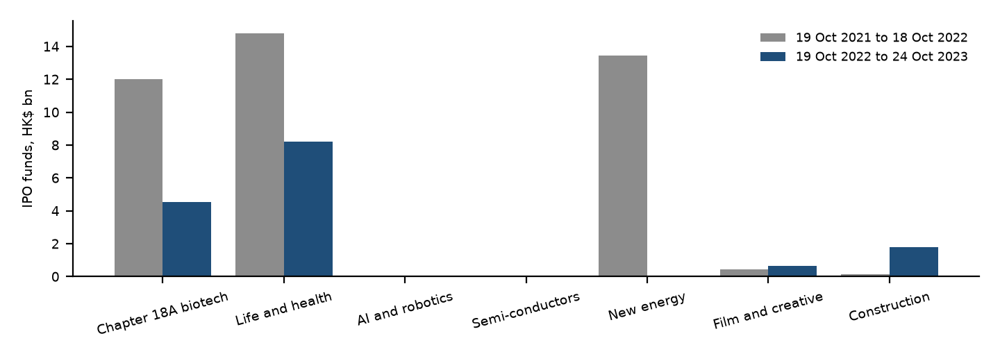

# Second run: the 2022 Policy Address only

Trigger: policy-funding-card. Input: the 2022 English XML.
This run does not read the 2026 sentences.

Delivered: 2022-10-19.
Market wording in the address: The address says Hong Kong has an active stock market. It states no IPO total and no turnover.

| Programme | Amount | Status | Verb as printed | Industries |
| --- | --- | --- | --- | --- |
| Co-Investment Fund | 30 HK$ billion | new in this address | "set aside $30 billion from the Future Fund to establish the Co-Investment Fund" | Enterprises setting up in Hong Kong |
| RAISe+ Scheme | 10 HK$ billion | new in this address | "We will earmark $10 billion to launch" | University research teams with potential to become start-ups |
| Strategic Tech Fund | 5 HK$ billion | already in place before this address | "making use of the $5 billion Strategic Tech Fund" | Life and health technology, AI and data science, advanced manufacturing and new energy technology |

New in this address: HK$40,000.0 million. The HK$5 billion Strategic Tech Fund already existed and is not in that total.

This card does not contain the additional HK$1 billion earmarked for the Innovation and Technology Venture Fund in 2026. That sentence is in the 2026 XML.

Outcome window: 19 Oct 2022 to 24 Oct 2023, the day of delivery to the day before the 2023 address. Baseline: 19 Oct 2021 to 18 Oct 2022.

| Industry named in 2022 | Tag basis | Before: IPOs / HK$ million / share | After: IPOs / HK$ million / share |
| --- | --- | --- | --- |
| Chapter 18A biotech (B marker) | HKEX B marker | 12 / 11,999.7 / 9.4% | 9 / 4,526.9 / 9.6% |
| Life and health | name screen | 17 / 14,814.5 / 11.6% | 17 / 8,215.2 / 17.4% |
| AI and robotics | name screen | 0 / 0.0 / 0.0% | 0 / 0.0 / 0.0% |
| New energy | name screen | 1 / 13,458.0 / 10.5% | 0 / 0.0 / 0.0% |
| Main Board | NLR rows | 85 / 127,696.1 / 100% | 79 / 47,269.0 / 100% |

Advanced manufacturing is also named in 2022. No keyword set separates it from other manufacturers by name, so it is not stated in source.

New energy before the address is one IPO, Tianqi Lithium, HK$13,458.0 million on 13 July 2022. After the address the screen finds none. Life and health raised less money after the address and took a larger share, because the Main Board fell from HK$127,696.1 million to HK$47,269.0 million.

Board context, Market Statistics 2023, p.3: IPO funds HK$46,294.9 million in calendar 2023, down 55.8%; average daily turnover HK$105,012 million, down 15.9%.

Label: following year recorded, source does not attribute it to the address.
