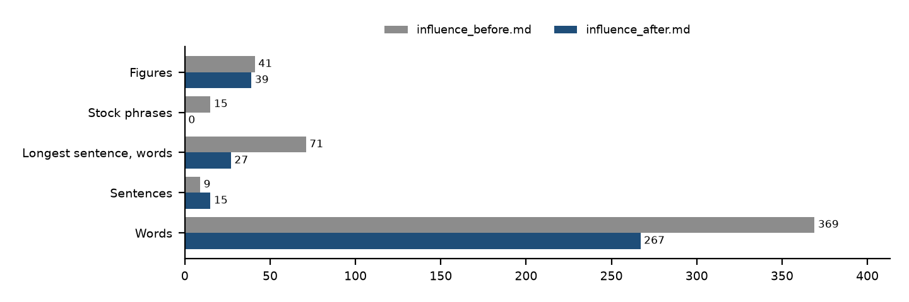

# Assignment 3 reflection

CHEUNG Yuk Yuen, AI Application Trainee, Department of Physics.

## Where I found it

The assignment names better-writing. The page is https://skills.sh/forjd/better-writing/better-writing. I used it on the findings paragraph, because the tables have to keep the source figures and only the explanation needed work.

## First use

I wrote a rough draft of the findings, `outputs/influence_before.md`, and ran the skill's five steps on it: read the brief, set the reading, audit against the reference lists, rewrite, and run the preflight checks. The record is `outputs/better_writing_run.md`. The audit found throat-clearing, significance inflation, and an essay closer. Two clauses claimed a cause the figures do not show: "a testament to the power of targeted policy" and "a driving force behind the market's transformation". The skill says to cut inflation or restate it at its true strength, so both went.

| Measure | Before | After |
| --- | --- | --- |
| Words | 369 | 267 |
| Sentences | 9 | 15 |
| Longest sentence, words | 71 | 27 |
| Stock phrases | 15 | 0 |
| Figures | 41 | 39 |

Every figure in the rewrite is also in the draft. A script checks that.

## Friction

The skill edits prose and does not check facts. When the draft said "testament to the power of targeted policy", the skill's rule removed the clause, but deciding that the claim was unsupported needed the funding status and the fund's launch date from the card.

## Beside the skill from Assignment 2

policy-funding-card decides which sentence enters the table, whether the money is new, and which IPOs count. better-writing decides how the findings read once those facts are fixed. A rewrite may not add a number that is not in the draft.

## How I would use it at work

After a technical note or a policy summary is checked against the source, I would use it on the explanation I hand to a colleague. It replaces a manual pass that deletes filler and inflated claims. It does not replace the check against the XML or the HKEX file.

## What I would change first in a fork

I would add one preflight line: every figure in the rewrite must appear in the draft, checked by a script, with tables, amounts, dates, and labels frozen.
